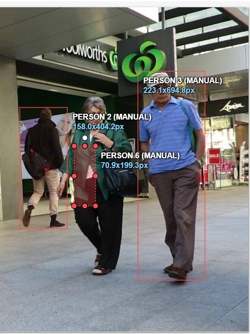
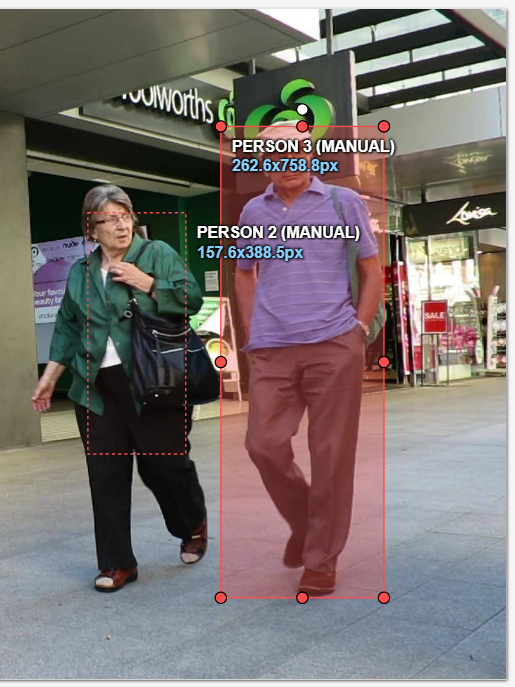

# Báo cáo cá nhân — Lưu Nhật Nam (2A202603243)

Đoạn video: MOT17-09, 150 frame (frame 1–150), nguồn MOTChallenge, giấy phép CC BY-NC-SA 3.0.

## 0. Thông tin học viên

- Họ tên: Lưu Nhật Nam
- MSSV: 2A202603243
- Mã đề (A/B/C): C
- Email: 26ai.namln2@vinuni.edu.vn
- Link repository: https://github.com/LuuNhatNamm/K5-L2A-Day05-LuuNhatNam-2A202603243--MOTTracking
- Giờ bắt đầu: 17h
- Giờ kết thúc: 7h30

## 1. Xem trước đoạn video (CP0)

Đối chiếu bảng nhận diện đề C với ảnh của đoạn MOT17-09 dùng cho job #15. Số frame theo CVAT (0–149). Dấu `~` chỉ mốc ước lượng khi tua xem. Bảng ghi quan sát từ ảnh gốc của đoạn video.

| Mã | Frame xuất hiện | Frame cuối thấy được | Rẽ / dừng / đổi tốc độ ở frame | Bị che ở frame | Ghi chú |
|---|---|---|---|---|---|
| P1 | 0 | 149 | ~60–70: xoay người, rồi bước dần về phía cửa hàng. | ~30–55: người đi ngang tiền cảnh che một phần rồi khuất khỏi tầm nhìn; thấy rõ lại khoảng frame 55. | Người áo đen, quần jeans trong cửa hàng Vodafone. |
| P2 | ~60 (thấy ở frame mẫu 61) | 149 | ~65–85: bước từ bên trái ra, sau đó đi về phía cửa. | ~60–75: phần thân dưới bị quầy và mép cửa kính che khi bước ra. | Người áo sáng có dải màu cam, đi cạnh P1 về cuối đoạn. |
| P3 | 0 (một phần ở mép phải) | 149 | Đi đều về phía camera và dịch dần sang trái trong ảnh, chưa thấy lần dừng rõ. | Đầu đoạn bị mép phải cắt một phần cơ thể. | Người áo polo xanh, đội mũ sáng màu. |
| P4 | 0 | ~105  | ~55–75: bước chậm, cúi hoặc quay về phía trẻ nhỏ trước cửa Woolworths. | Từ ~105–110: khó thấy do người đi ở tiền cảnh che. | Người mang túi hồng, đi cạnh trẻ nhỏ. |
| P5 | 0 (một phần ở mép trái) | 149 (chỉ thấy một phần) | ~35–45: xoay người sang phải; sau đó đi chéo ra xa camera. | ~110–125: đi sau người áo xanh lá; ~135–149: tiếp tục bị hai người ở tiền cảnh che, thấy lại một phần ở frame 149. | Người áo khoác đen, khăn đỏ, quần be. |

## 2. Keyframe và thời gian (CP1, CP4)

Số liệu lấy từ `src/check_submission.py` và `annotations.xml`. Cả 5 điểm nhận diện của đề C đều nằm trong một box ở frame mẫu tương ứng. ID trong CVAT for video và MOT được đối chiếu theo các frame có mặt.

| Mã | ID CVAT / MOT | Số keyframe | Keyframe ở frame | Số frame có mặt | Keyframe / 100 frame | Thời gian (phút) | Chỗ khó |
|---|---|---:|---|---:|---:|---|---|
| P1 | 3 / 2 | 15 | 0, 10, 20, 30, 50, 60, 70, 80, 90, 100, 110, 120, 130, 140, 149 | 150 | 10.0 |  | Che một phần ở frame 30–59. |
| P2 | 4 / 5 | 10 | 60, 70, 80, 90, 100, 110, 120, 130, 140, 149 | 90 | 11.1 |  | Che một phần ở frame 60–79 khi bước ra. |
| P3 | 1 / 4 | 18 | 28, 30, 38, 40, 48, 50, 58, 60, 68, 70, 78, 88, 98, 108, 119, 129, 139, 149 | 122 | 14.8 |  | Thấy một phần ở mép phải lúc đầu. Bản xuất bắt đầu có box ở frame 28. |
| P4 | 2 / 1 | 8 | 0, 10, 20, 30, 40, 50, 90, 100 | 110 | 7.3 |  | Che một phần ở frame 100–109, bật `outside` ở frame 110. |
| P5 | 0 / 3 | 16 | 10, 20, 30, 40, 50, 60, 70, 80, 90, 100, 110, 118, 119, 120, 130, 149 | 130 | 12.3 |  | Che một phần từ frame 118, khuất hẳn ở 139–148. Bản xuất bắt đầu có box ở frame 10. |
| **Tổng** | | **67** | | **602** | **11,1** | | |

Keyframe / 100 frame của cả bài = 67 ÷ 602 × 100 ≈ 11,1.

P3 có nhiều keyframe nhất (18), trong đó có các cặp mốc bật và tắt `occluded` ở đoạn 30–68. Cần bổ sung thời gian thực tế và lý do đặt các keyframe khi gán.

## 3. Đoạn bị che (CP2)

CP2 yêu cầu theo dõi **P1** (ID 3 trong CVAT for video, ID 2 trong MOT). Các mốc dưới đây lấy từ bản xuất mới.

| Mốc | Frame |
|---|---|
| Bật `occluded` | 30 |
| Bật `outside` khi mất hẳn | Cần rà lại đoạn 30–55. Bản xuất hiện có box xuyên suốt 0–149. |
| Tắt `outside` khi hiện lại | Chưa có mốc trong bản xuất. |
| Tắt `occluded` | 60 |

P1 giữ cùng ID suốt đoạn 0–149. Cần xác nhận có khoảng khuất hẳn hay chỉ che một phần, rồi bổ sung thời gian khuất, lý do giữ ID và ba ảnh minh chứng của P1.

### Đoạn che của P5 trong bản xuất

P5 là ID 0 trong CVAT for video, ID 3 trong MOT và hiện là PERSON 2 trên ảnh chụp. `Occluded` bật từ frame 118. `Outside` bật ở frame 139 và tắt ở frame 149 trên cùng track. Khoảng khuất hẳn là 10 frame (139–148), khoảng 0,33 giây ở 30 fps. Cờ `occluded` vẫn bật ở frame 149.

Ba ảnh dưới đây minh họa P5 trước khi bật cờ và trong đoạn che một phần.





## 4. Tự review ID (CP3)

Lượt 1 theo người (đi ngược từ frame 149 về 0 trên CVAT), lượt 2 theo cảnh (nhảy 10 frame). Ít nhất 3 dòng; không có lỗi thì ghi một dòng "đã kiểm hai lượt, không lỗi".
  đã kiểm hai lượt, không lỗi.
Loại lỗi dùng đúng một trong 7 mã: `id_switch`, `fragmentation`, `lost`, `merge`, `false_track`, `drift`, `flag`.

| Frame | Mã người | Loại lỗi | Mô tả một câu | Phát hiện ở lượt | Đã sửa? |
|---:|---|---|---|---|---|
| | | | | | |
| | | | | | |
| | | | | | |

Tổng hợp số lỗi theo loại:

| `id_switch` | `fragmentation` | `lost` | `merge` | `false_track` | `drift` | `flag` |
|---:|---:|---:|---:|---:|---:|---:|
| | | | | | | |

Lỗi nào chỉ lượt 2 (theo cảnh) mới thấy, lượt 1 (theo người) không thấy? Vì sao?

...

## 5. File xuất và kết quả tự kiểm (CP4)

| Kiểm tra | Kết quả |
|---|---|
| Tên file MOT 1.1 | `LuuNhatNam_mot.zip` (chỉ chứa tệp nhãn) |
| Tên file CVAT for video 1.1 | `LuuNhatNam_cvat_video.zip` (chỉ chứa `annotations.xml`) |
| Số track ID khác nhau trong `gt/gt.txt` (phải là 5) | 5 ID, 602 box |
| Frame `outside` không có dòng trong `gt.txt` (đúng / sai) | Đúng. P5 (MOT ID 3) vắng ở frame MOT 140–149 (CVAT 139–148), có mặt lại tại frame MOT 150 (CVAT 149). P4 (MOT ID 1) không có dòng từ frame MOT 111 đến hết đoạn. |
| Job đã completed trên CVAT máy cá nhân | Có. Job #15, task đề C, trạng thái `completed` trên CVAT local. |

Kết quả chạy `src/check_submission.py` trên hai ZIP trong repo.

```text
Số frame in theo CVAT (bắt đầu từ 0). Trong gt.txt, frame_id = frame CVAT + 1.

=== File MOT 1.1: LuuNhatNam_mot.zip ===
  Số track ID: 5   |   Tổng số box: 602
  [OK]        Đúng 5 track ID.

  Track | Frame có mặt | Số frame | Đoạn vắng (outside)
      1 |   0–109      |      110 | -
      2 |   0–149      |      150 | -
      3 |  10–149      |      130 | 139–148
      4 |  28–149      |      122 | -
      5 |  60–149      |       90 | -


=== File CVAT for video 1.1: LuuNhatNam_cvat_video.zip ===

  Track | Nhãn   | Frame thấy | Keyframe | KF/100 frame | Frame occluded | Lần bật outside
      0 | person |        130 |       16 |         12.3 |             22 |               1
              Track 0: keyframe ở frame [10, 20, 30, 40, 50, 60, 70, 80, 90, 100, 110, 118, 119, 120, 130, 149]
      1 | person |        122 |       18 |         14.8 |             32 |               0
              Track 1: keyframe ở frame [28, 30, 38, 40, 48, 50, 58, 60, 68, 70, 78, 88, 98, 108, 119, 129, 139, 149]
      2 | person |        110 |        8 |          7.3 |             10 |               1
              Track 2: keyframe ở frame [0, 10, 20, 30, 40, 50, 90, 100]
      3 | person |        150 |       15 |         10.0 |             30 |               0
              Track 3: keyframe ở frame [0, 10, 20, 30, 50, 60, 70, 80, 90, 100, 110, 120, 130, 140, 149]
      4 | person |         90 |       10 |         11.1 |             20 |               0
              Track 4: keyframe ở frame [60, 70, 80, 90, 100, 110, 120, 130, 140, 149]

  Tổng: 67 keyframe / 602 frame có mặt = 11.1 keyframe / 100 frame
  [OK]        Đọc được 5 track từ annotations.xml.

=== Tóm tắt ===
  Lỗi: 0   |   Cảnh báo: 0
  Đạt. Dán phần tóm tắt này vào báo cáo mục 5.
```

## 6. Ba câu kết

1. Nếu được gán lại, bạn sẽ đặt keyframe khác ở đâu? Vì sao?

   Xem frame 130–138 của P5 (ID 0 trong bản xuất CVAT). Nếu box bị trôi khi người bị che, thêm keyframe ngay tại frame bắt đầu lệch.

2. Có chỗ nào bạn không chắc "cùng ID hay ID mới"? Bạn đã quyết định và ghi chú thế nào?

   P5 (ID 0 trong bản xuất CVAT) khuất ở frame 139–148 và giữ ID khi hiện lại ở frame 149. Ghi mốc này và dấu hiệu bạn thấy để nhận ra cùng người, như trang phục hoặc hướng di chuyển.

3. Một lỗi ID trong job của bạn (nếu không còn sót, chọn lỗi đã sửa) có thể làm xe tự lái dự đoán sai chuyển động của người đó như thế nào? Lỗi đó ảnh hưởng MOTA hay IDF1 nhiều hơn?

   Tôi không phát hiện lỗi ID khi rà soát. Giả sử P5 (ID 0 trong bản xuất CVAT) bị đổi ID ở frame 149, hệ thống có thể mất lịch sử quỹ đạo và dự đoán sai hướng hoặc tốc độ của người đó. Nếu ID sai kéo dài qua nhiều frame, IDF1 thường bị ảnh hưởng nhiều hơn MOTA.

## Bonus (nếu làm)

### B1 — Hai người đi sát

...

### B2 — So cách đặt keyframe

| Cách đặt | Số keyframe | Frame trôi nhất | Ghi chú |
|---|---:|---:|---|
| Đều mỗi 30 frame | | | |
| Theo chỗ đổi hướng | | | |

...

### B3 — So với tracker có sẵn

| Frame | Mã người | Tracker làm gì | Nhãn của bạn | Giải thích (đoán rồi sửa / ghép IoU / box score thấp / ngoại hình) |
|---:|---|---|---|---|
| | | | | |
| | | | | |

## 7. Tài liệu tham khảo và công cụ AI đã dùng

- Dữ liệu và nguồn ảnh minh họa: MOT17, MOTChallenge (Milan et al., 2016). Giấy phép CC BY-NC-SA 3.0.
- Codex hỗ trợ đối chiếu số liệu trong hai bản xuất, kết quả tự kiểm và chú thích ảnh minh chứng.
